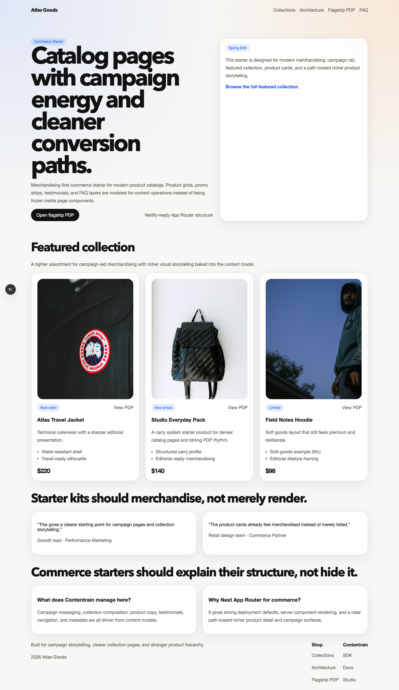
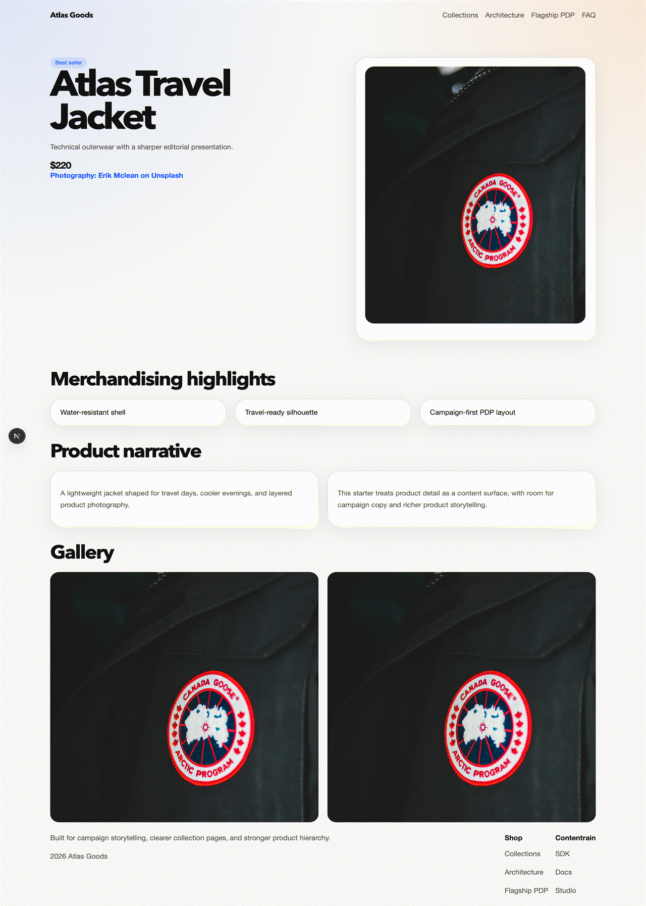

<!-- cover -->


# Contentrain Next Commerce

A Next.js (App Router) commerce starter: campaigns, curated collections and product detail pages, all driven by
content in `.contentrain/`. Contentrain is a content governance ecosystem for teams and AI agents: models, content and
the generated client live in git next to the code, and every change is a reviewable commit.



## What it shows

- A home page with the active promo campaign, featured products, a collection, testimonials and an FAQ.
- Statically generated product pages (`/products/[slug]`) with gallery, highlights and image credits.
- Statically generated collection pages (`/collections/[slug]`) that resolve their products by relation.
- Site chrome (navigation, footer, SEO defaults, site settings) read from singletons.
- An `/architecture` page that lists every model by domain, read from `.contentrain/models/`.

Every page reads content in React Server Components through the generated `#contentrain` client
(`@contentrain/query`). The queries are synchronous, with no runtime API calls.

## Use this template

Click **Use this template** on GitHub to create your own repository. You can also start from
[Contentrain Studio](https://contentrain.io/studio): choose this starter under "Start from a starter" and Studio creates
the repository from the template and connects it as a project, ready to edit.

## Quick start

Node 22 and pnpm 10:

```bash
pnpm install
pnpm dev        # http://localhost:3000
```

| Command | What it does |
|---|---|
| `pnpm dev` | Next.js dev server |
| `pnpm build` | Production build (all pages are prerendered) |
| `pnpm start` | Serve the production build |
| `pnpm check` | TypeScript check |
| `pnpm validate` | Validate `.contentrain/` against its models |
| `pnpm contentrain:generate` | Regenerate the typed client in `.contentrain/client/` after a model or content change |

CI (`.github/workflows/ci.yml`) runs install, validate, check and build on every push and pull request.

## Content model

| Model | Kind | Domain | Entries | Fields |
|---|---|---|---|---|
| `product` | collection | commerce | 3 | `name`, `slug`, `summary`, `description`, `price_label`, `badge`, `featured`, `primary_image`, `image_alt`, `image_credit_label`, `image_credit_href`, `gallery`, `highlights` |
| `catalog-collection` | collection | commerce | 1 | `name`, `slug`, `summary`, `featured_products` (relation to `product`) |
| `promo-campaign` | collection | commerce | 1 | `title`, `summary`, `href`, `theme`, `start_at`, `end_at` |
| `testimonial` | collection | marketing | 2 | `person_name`, `person_role`, `company_name`, `quote`, `rating`, `avatar` |
| `faq-item` | collection | marketing | 2 | `question`, `answer`, `category` |
| `navigation` | singleton | system | 1 | `announcement_label`, `items`, `cta_label`, `cta_href` |
| `footer` | singleton | system | 1 | `blurb`, `columns`, `legal_notice` |
| `seo-defaults` | singleton | system | 1 | `meta_title`, `meta_description`, `canonical_base`, `og_image` |
| `site-settings` | singleton | system | 1 | `site_name`, `site_tagline`, `theme_name`, `default_locale`, `og_image` |

Models are in `.contentrain/models/`, content in `.contentrain/content/<domain>/<model>/en.json`.

## Deploy

`netlify.toml` is committed: the build command is `pnpm deploy:netlify` and Netlify detects the Next.js runtime, so leave
the publish directory empty.

[](https://app.netlify.com/start/deploy?repository=https%3A%2F%2Fgithub.com%2FContentrain%2Fcontentrain-starter-next-commerce)

Any host that runs Next.js works the same way (`pnpm build`, then `pnpm start`).

## Contentrain

- Packages, CLI and agent tooling: [ai.contentrain.io](https://ai.contentrain.io)
- Next.js guide: [ai.contentrain.io/guides/frameworks#next-js-app-router](https://ai.contentrain.io/guides/frameworks#next-js-app-router)
- Query SDK: [ai.contentrain.io/packages/sdk](https://ai.contentrain.io/packages/sdk)
- Contentrain Studio: [contentrain.io/studio](https://contentrain.io/studio)

## License

[MIT](./LICENSE)
